<picture>
  <source media="(prefers-color-scheme: dark)" srcset="assets/a-autopilot-dark.svg">
  
</picture>

<p align="center">
  <a href="https://siddharthabbineni.in"></a>
  <a href="https://www.linkedin.com/in/siddharthabbineni/"></a>
  <a href="https://x.com/tHeSiD"></a>
</p>

<details>
<summary>How I think about automation</summary>

Code, cloud infrastructure, AI automation, and open source are the threads running through this profile. The diagram brings those interests together in an example of how a larger system could be built and operated.

Infrastructure and apps can move independently, with environment readiness connecting them. A change gets reviewed, provisioned, and verified; an application gets built once, tested, and promoted. Existing infrastructure can be reused when it already meets the app's needs. For coupled changes, add compatible infrastructure first, deploy the app, then clean up obsolete resources.

I'm interested in AI that helps with the whole loop: understanding dependencies, drafting code and tests, explaining changes, investigating failures, and turning findings into useful PRs. Automated checks, human review, and feedback keep that loop grounded. The amount of process should fit the project.

</details>

### 📈 telemetry

<picture>
  <source media="(prefers-color-scheme: dark)" srcset="assets/stats-dark.svg">
  
</picture>

<!-- upstream:start -->
<p>
  <a href="https://github.com/hhdebb/herdr-radar/pull/70"><picture><source media="(prefers-color-scheme: dark)" srcset="assets/pr-herdr-radar-70-dark.svg"></picture></a>
  <a href="https://github.com/webosbrew/youtube-webos/pull/487"><picture><source media="(prefers-color-scheme: dark)" srcset="assets/pr-youtube-webos-487-dark.svg"></picture></a>
  <a href="https://github.com/qintmb/herdr-theme-picker/pull/8"><picture><source media="(prefers-color-scheme: dark)" srcset="assets/pr-herdr-theme-picker-8-dark.svg"></picture></a>
  <a href="https://github.com/kryptamine/herdr-auto-title/pull/120"><picture><source media="(prefers-color-scheme: dark)" srcset="assets/pr-herdr-auto-title-120-dark.svg"></picture></a>
</p>
<!-- upstream:end -->

### `$ kubectl describe engineer siddharth`

```yaml
apiVersion: humans.dev/v13            # 13+ years, still backwards compatible
kind: AutomationEngineer
metadata:
  name: siddharth-abbineni
  aliases: [wapenshaw, tHeSiD]
  labels:
    role: sr-technology-automation-engineer
    also: [ai-automation, cloud-architect, solutions-architect]
spec:
  replicas: 1                         # working on automating this too
  interests: [ai-automation, developer-tools, cloud-platforms, open-source]
  clouds:
    primary: azure
    failover: [aws, gcp]
  languages: [rust, go, python, csharp, typescript]
  strategy:
    type: RollingUpdate               # automate, observe, repeat
  resources:
    requests:
      toil: "0"
    limits:
      manual-steps: "0"
status:
  phase: Running
  conditions:
    - type: AzureCertified
      status: "True"
      count: 4
    - type: OpenToInterestingProblems
      status: "True"
```

### 🧰 `cat stack.yaml`

| area | tools & experience |
| :-- | :-- |
| 🤖 **ai & automation** | <br><sub>LLM agents · Azure OpenAI · Azure Cognitive Services · platform automation · CI/CD architecture</sub> |
| 🦀 **languages** | <br><sub>.NET · ASP.NET Core · Node.js</sub> |
| ☁️ **cloud & platform** | <br><sub>AKS · EKS · Bicep · Helm · Argo CD · GitOps · Azure DevOps</sub> |
| 🗄️ **data** | <br><sub>SQL Server · REST APIs · cloud, on-prem & third-party integration</sub> |
| 🎨 **frontend** |  |
| 🔭 **observability & security** | <br><sub>Azure Monitor · App Insights · OpenTelemetry · Defender for Cloud · SonarQube</sub> |

### 🩺 health checks

<p>
  
  
  
  
</p>

---

<p align="center">
  <code>$ ping siddharth</code><br>
  <sub>64 bytes from <a href="https://siddharthabbineni.in">siddharthabbineni.in</a> · 64 bytes from <a href="https://www.linkedin.com/in/siddharthabbineni/">linkedin</a> · 64 bytes from <a href="https://x.com/tHeSiD">x.com</a> · 0% packet loss</sub>
</p>
