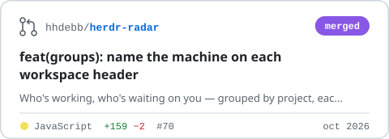

<picture>
  <source media="(prefers-color-scheme: dark)" srcset="../assets/b-agent-dark.svg">
  
</picture>

<p align="center">
  <a href="https://siddharthabbineni.in"></a>
  <a href="https://www.linkedin.com/in/siddharthabbineni/"></a>
  <a href="https://x.com/tHeSiD"></a>
</p>

### 🧠 recent context

<picture>
  <source media="(prefers-color-scheme: dark)" srcset="../assets/stats-dark.svg">
  
</picture>

<!-- upstream:start -->
<p>
  <a href="https://github.com/hhdebb/herdr-radar/pull/70"><picture><source media="(prefers-color-scheme: dark)" srcset="../assets/pr-herdr-radar-70-dark.svg"></picture></a>
  <a href="https://github.com/webosbrew/youtube-webos/pull/487"><picture><source media="(prefers-color-scheme: dark)" srcset="../assets/pr-youtube-webos-487-dark.svg"></picture></a>
  <a href="https://github.com/qintmb/herdr-theme-picker/pull/8"><picture><source media="(prefers-color-scheme: dark)" srcset="../assets/pr-herdr-theme-picker-8-dark.svg"></picture></a>
  <a href="https://github.com/kryptamine/herdr-auto-title/pull/120"><picture><source media="(prefers-color-scheme: dark)" srcset="../assets/pr-herdr-auto-title-120-dark.svg"></picture></a>
</p>
<!-- upstream:end -->

### ◆ system prompt

> You are **Siddharth**, a senior technology automation engineer with 13+ years of building cloud platforms, distributed systems and enterprise architecture.
> Prefer automation over toil. Prefer boring infrastructure over exciting incidents. If a task runs twice, write the tool that runs it the third time.
> You are currently building **Astra** at Assurant: a cloud automation platform that standardises provisioning across clouds for the whole enterprise.

### 🛠️ tools

| tool | what it does | backed by |
| :-- | :-- | :-- |
| `ai.automate` | puts LLMs to work where scripts run out | LLM agents · Azure OpenAI · Cognitive Services |
| `code.write` | services, CLIs and glue, in whichever language fits |  |
| `cloud.provision` | infrastructure as code, multi-cloud |  Bicep |
| `config.apply` | configuration and release automation |  Azure DevOps |
| `k8s.operate` | cluster lifecycle from dev to prod |  AKS · EKS · Helm · Argo CD |
| `data.query` | stores, caches and integrations |  SQL Server |
| `ui.render` | when a human needs a screen |  |
| `observe` | traces, metrics, logs, security |  OpenTelemetry · App Insights · Defender · SonarQube |

### 🧠 memory

```text
[2025 → now]  sr technology automation engineer  · assurant         astra, aks lifecycle, .net + python services, ansible ci/cd
[2020 → 2025] senior technical specialist        · pinion services  solutions architect lead for a european consumer bank:
                                                                     azure & aws migrations, 8+ core banking microservices,
                                                                     ai credit-risk prototypes on azure openai
[2016 → 2020] senior software engineer           · melite tech      led a team of 5 on an education erp/crm
[2012 → 2016] it consultant                      · dps nacharam     led a team of 8 on 3 erp/crm systems
[2010 → 2012] application developer              · qsp, time inc.   erp portal, ssis pipelines, stamford ct
```

### ✅ evals passed

<p>
  
  
  
  
</p>

---

<p align="center">
  <code>$ agent handoff --to human</code><br>
  <sub><a href="https://siddharthabbineni.in">siddharthabbineni.in</a> · <a href="https://www.linkedin.com/in/siddharthabbineni/">linkedin</a> · <a href="https://x.com/tHeSiD">x.com</a></sub>
</p>
