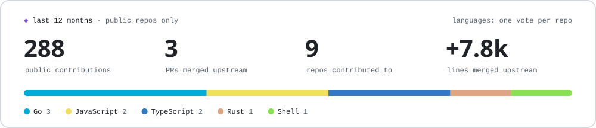
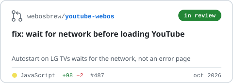
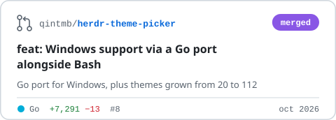
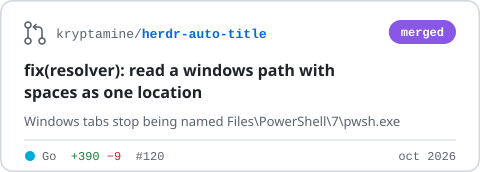
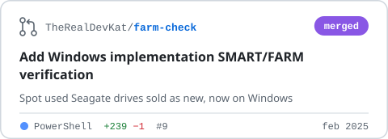

<picture>
  <source media="(prefers-color-scheme: dark)" srcset="../assets/c-polyglot-dark.svg">
  
</picture>

<p align="center">
  <a href="https://siddharthabbineni.in"></a>
  <a href="https://www.linkedin.com/in/siddharthabbineni/"></a>
  <a href="https://x.com/tHeSiD"></a>
</p>

<p align="center">
  
</p>

### 📈 build log

<picture>
  <source media="(prefers-color-scheme: dark)" srcset="../assets/stats-dark.svg">
  
</picture>

<!-- upstream:start -->
<p>
  <a href="https://github.com/webosbrew/youtube-webos/pull/487"><picture><source media="(prefers-color-scheme: dark)" srcset="../assets/pr-youtube-webos-487-dark.svg"></picture></a>
  <a href="https://github.com/qintmb/herdr-theme-picker/pull/8"><picture><source media="(prefers-color-scheme: dark)" srcset="../assets/pr-herdr-theme-picker-8-dark.svg"></picture></a>
  <a href="https://github.com/kryptamine/herdr-auto-title/pull/120"><picture><source media="(prefers-color-scheme: dark)" srcset="../assets/pr-herdr-auto-title-120-dark.svg"></picture></a>
  <a href="https://github.com/TheRealDevKat/farm-check/pull/9"><picture><source media="(prefers-color-scheme: dark)" srcset="../assets/pr-farm-check-9-dark.svg"></picture></a>
</p>
<!-- upstream:end -->

## 📜 CHANGELOG.md

All notable changes to this engineer are documented here. The format follows [Keep a Changelog](https://keepachangelog.com) and the engineer follows [SemVer](https://semver.org), mostly.

### [5.0.0] · 2025-08 · Sr Technology Automation Engineer @ Assurant
#### Added
- **Astra**, a flagship cloud automation platform that standardises infrastructure provisioning and multi-cloud workflows across the enterprise
- End-to-end ownership of **AKS** clusters, from dev to prod: deployments, releases, high availability
- Configuration management and CI/CD automation with **Ansible**
- **Rust**, **Go** and **AI automation** to the toolbox
#### Deprecated
- Doing anything by hand more than twice

### [4.0.0] · 2020-12 · Senior Technical Specialist @ Pinion Services
#### Added
- Solutions architect lead for a European consumer bank: Azure & AWS migration roadmap, **8+ core banking microservices**
- .NET Core / AKS collections engine, **+30% debt recovery**
- AI-driven credit-risk prototypes on Azure Cognitive Services & OpenAI
- Terraform IaC and C4 system designs
- Product lead on internal products: regulatory APIs, a document management center, scaling an app from 100+ to 1,000+ users

### [3.0.0] · 2016-11 · Senior Software Engineer @ Melite Technologies
#### Added
- Led a team of 5 on an education ERP/CRM, rolled out to 5 institutions and 15,000+ students and staff
- REST APIs serving 10,000+ requests a day

### [2.0.0] · 2012-07 · IT Consultant @ Delhi Public School, Nacharam
#### Added
- Led a team of 8 on 3 ERP/CRM systems for 2,000+ users; automated campaigns cut manual messaging by ~60%

### [1.0.0] · 2010-12 · Application Developer @ QSP, Time Inc. (Stamford, CT)
#### Added
- Lead dev on the internal ERP portal; SSIS pipelines moving millions of records nightly; GL reconciliation automation (−75% manual entry)

### [0.1.0] · 2009 · B.Tech, Computer Science @ CVR College of Engineering
- Initial release

## 🧩 dependencies

```toml
[dependencies]
languages   = ["rust", "go", "python", "csharp", "typescript"]
ai          = ["llm-agents", "azure-openai", "azure-cognitive-services"]
cloud       = { primary = "azure", also = ["aws", "gcp"] }
platform    = ["kubernetes", "aks", "eks", "helm", "argo-cd", "docker"]
automation  = ["terraform", "bicep", "ansible", "github-actions", "azure-devops"]
data        = ["sql-server", "postgresql", "mysql", "redis"]
observe     = ["opentelemetry", "app-insights", "azure-monitor", "kibana"]
frontend    = ["react", "angular"]

[dev-dependencies]
certifications = [
  "azure-solutions-architect-expert",
  "azure-devops-engineer-expert",
  "azure-administrator-associate",
  "azure-developer-associate",
]
```

---

<p align="center"><sub><code>[Unreleased]</code> · whatever we build together · <a href="https://www.linkedin.com/in/siddharthabbineni/">say hi</a></sub></p>
